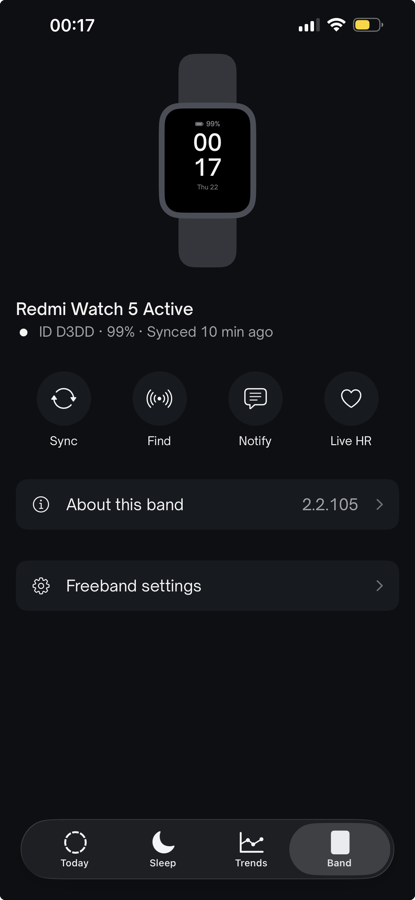

# Freeband

Read your Xiaomi Smart Band 10 / 10 Pro, Redmi Watch 5 Active or Xiaomi Watch S1 Active on iPhone without Mi Fitness or a Xiaomi account. Freeband talks to the band directly over Bluetooth LE, and your data stays on your phone.

<p>
  
  
  
  
</p>

<sub>Screenshots use demo data.</sub>

**Status:** early. Version 0.5 is in public beta on [TestFlight](https://testflight.apple.com/join/Qq9A6c1E) and not on the App Store yet. Website: [freeband.cobanov.dev](https://freeband.cobanov.dev) ([Türkçe](https://freeband.cobanov.dev/tr)), including [How we did it](https://freeband.cobanov.dev/story), the story of how the protocol was worked out, and [Try it yourself](https://freeband.cobanov.dev/guide).

## What works

| Feature | State |
|---|---|
| Authentication and the encrypted channel (BLE V2) | verified on a Band 10 Pro |
| Battery, live steps, heart rate and calories | verified |
| Notifications from Freeband, find band (vibrate), clock sync | verified |
| Listing and fetching the band's activity files | verified |
| Redmi Watch 5 Active: authentication, battery, live stats, and fetching and parsing its daily summary, per-minute and sleep files | verified on firmware 2.2.105 |
| Xiaomi Watch S1 Active, on the older BLE V1 channel: authentication, battery, live stats, notifications, its activity files, and sleep sessions from the watch's fell-asleep and woke-up events. The watch ignores Find, so Freeband hides it | verified on firmware 1.4.174 |
| Find Phone: with Stay connected on (Band tab), Freeband keeps a session open in the background, and the watch's Find Phone rings the iPhone, also locked and on silent. Mi Fitness can't connect while it's on ([docs/STAY-CONNECTED.md](docs/STAY-CONNECTED.md)) | verified on a Xiaomi Watch S1 Active, firmware 1.4.174; a whole night idle not tested yet |
| Mi Band 8, on BLE V1 | expected to work: Gadgetbridge puts it on the same channel as the Watch S1 Active. Not tested on a band yet ([#4](https://github.com/cobanov/freeband/issues/4)) |
| Parsing them: per-minute data, daily summary, sleep and sleep stages, manual readings | implemented and tested against fixtures; not yet checked with real files from a Band 10 |
| Sleep, Recovery and Strain scores with contributors and confidence | implemented (algorithm v1) |
| English and Turkish, light and dark themes | done |
| Optional web hub: REST API, web panel, webhooks, CSV/JSON export | live at freeband.cobanov.dev |
| Alarms, health monitoring settings, Do Not Disturb, weather, watch faces | not built yet |
| Replacing Mi Fitness entirely (background connection, file acknowledgement) | not built yet |



<sub>The Band screen with a real Redmi Watch 5 Active connected.</sub>

## How it works

1. iOS keeps the band connected, so the app picks it up again without pairing: service `FE95` with characteristics `005E` (notify) and `005F` (write). Older bands such as the Watch S1 Active offer the BLE V1 channel instead (`0051`, `0052`, `0053`), which has its own framing and encrypts each message with AES-CCM ([`docs/BLE-V1.md`](docs/BLE-V1.md)) in place of step 4; the key, the handshake and the activity files are the same.
2. The 16-byte auth key is created by Xiaomi's server when the band is first paired in Mi Fitness. On iPhone it sits in the Mi Fitness folder in the Files app. Freeband asks you to pick that folder, reads the key on the phone and keeps it in the Keychain.
3. Handshake:
   - The phone and band swap nonces.
   - HKDF-SHA256 (`"miwear-auth"`) turns the key and nonces into session keys.
   - The band's HMAC proves the key.
   - The phone introduces itself as `device_type = iOS`, encrypted with AES-CCM.
4. After that, commands are protobuf messages in `a5 a5` frames with CRC16, encrypted with AES-128-CTR.
5. History comes as activity files, each with a 7-byte file ID. Files arrive in chunks ending with a CRC32. Freeband never acknowledges them, so nothing is deleted from the band.

The full write-up, with source references:
- [`docs/STORY.md`](docs/STORY.md): the story, step by step.
- [`findings.md`](findings.md): protocol findings.
- [`docs/CAPABILITIES.md`](docs/CAPABILITIES.md): command map.
- [`docs/ACTIVITY.md`](docs/ACTIVITY.md): activity file formats.
- [`docs/PLAN.md`](docs/PLAN.md): product plan and score formulas.
- [`docs/BLE-V1.md`](docs/BLE-V1.md): the older BLE V1 channel, and what the Watch S1 Active showed.
- [`docs/STAY-CONNECTED.md`](docs/STAY-CONNECTED.md): Stay connected (the held session) and Find Phone.

The docs are in Turkish, except `docs/BLE-V1.md` and `docs/STAY-CONNECTED.md`.

## Repository

| Path | What |
|---|---|
| `ios/` | the SwiftUI app (iOS 17+). Generate the project with [XcodeGen](https://github.com/yonaskolb/XcodeGen) (`cd ios && xcodegen generate`). |
| `ios/tests/` | standalone test harnesses: protocol vectors, key reader, activity parsers, analytics, ingest, and an app↔hub contract test |
| `hub/` | the optional Cloudflare Worker + D1 hub (Hono, vitest) |
| `design/`, `scripts/` | design tokens shared by the app and the hub, plus their generator |
| `docs/` | findings, plan, design spec, story |

Running the tests:

```sh
# activity parsers (Swift) and the Python reference
cd ios/tests/activity/swift && swiftc ../../../Freeband/Band/ActivityFiles.swift main.swift -o /tmp/act && /tmp/act
cd ios/tests/activity && python3 activity_ref.py --selftest

# analytics
cd ios/tests/analytics && swiftc ../../Freeband/Analytics/*.swift main.swift -o /tmp/an && /tmp/an

# hub
cd hub && npm install && npx tsc --noEmit && npx vitest run
```

## Try it yourself

Freeband isn't on the App Store yet, so for now you build it from source. You need an iPhone with iOS 17 or later, a Band 10, 10 Pro, Redmi Watch 5 Active or Xiaomi Watch S1 Active (a Mi Band 8 should work too, untested), and a Mac with Xcode 27 and a free Apple ID. The same guide with more detail is at [freeband.cobanov.dev/guide](https://freeband.cobanov.dev/guide).

1. **Pair the band with Mi Fitness once**, if it isn't already, and let it sync. This is the only time you need Mi Fitness: Xiaomi's server creates the band's key during pairing.
2. **Check the key folder.** In the Files app, On My iPhone should show a `Mi Fitness` folder.
3. **Get the code:**
   ```sh
   git clone https://github.com/cobanov/freeband
   cd freeband/ios
   brew install xcodegen
   ```
4. **Sign it as yourself.** In `ios/project.yml`, set `DEVELOPMENT_TEAM` to your team ID and `PRODUCT_BUNDLE_IDENTIFIER` to an identifier of your own. With a free Apple ID the app runs for 7 days, then you build it again.
5. **Generate the project and install it:**
   ```sh
   xcodegen generate
   open Freeband.xcodeproj
   ```
   - Turn on Developer Mode on the iPhone.
   - Pick the iPhone as the run destination and press Run.
   - Trust your developer certificate under Settings → General → VPN & Device Management.

   With SideStore or AltStore on the iPhone, you can skip steps 4 and 5: `sh tools/build-ipa.sh` (from `ios/`) writes an unsigned `build/Freeband.ipa`, which they sign with your Apple ID when you install it. AirDropped to the iPhone, the file lands in Files › Downloads.
6. **Read the key.** In Freeband, tap Get started, then Choose folder, then go to Browse → On My iPhone → Mi Fitness → Open.
7. **Connect.** Close Mi Fitness from the app switcher, keep the band close and tap Connect.
8. **Keep Mi Fitness out of the way.** Turn off its Background App Refresh or offload it (see below).

## Using it with your band

- **Never unpair the band in Mi Fitness and never factory-reset it.** Either one changes the key, and you would need Mi Fitness again to get the new one.
- Pairing a brand-new band without Mi Fitness isn't possible yet: the key comes from Xiaomi's server.
- Mi Fitness and Freeband can't hold the band's channel at the same time. Close Mi Fitness while Freeband syncs.
- Mi Fitness acknowledges activity files, and the band then deletes them. To keep your history for Freeband, turn off Mi Fitness's background refresh or offload the app. Offloading keeps its folder, and the key with it.

## Credits

Freeband was built from the protocol knowledge in these projects:
- [Gadgetbridge](https://codeberg.org/Freeyourgadget/Gadgetbridge)
- [AstroBox](https://github.com/AstralSightStudios)
- [xiaomi-band-ios-export](https://github.com/artyomxx/xiaomi-band-ios-export)
- [blueband-map](https://github.com/LordierClaw/blueband-map)
- [band9-rust-ios](https://github.com/ireescc277-dotcom/band9-rust-ios)

The Swift code was written from our own documentation of the protocol, not translated from these projects.

## License

- **Code:** MIT, see [LICENSE](LICENSE).
- **Fixtures:** the `ios/tests/activity/fixtures/gb_*.json` test vectors come from Gadgetbridge's tests and stay under AGPL-3.0-or-later ([details](ios/tests/activity/fixtures/README.md)).
- **Font:** Open Sauce Sans is under the SIL Open Font License.

Freeband is an independent project and is not affiliated with Xiaomi. Xiaomi, Mi Band and Mi Fitness are trademarks of Xiaomi Inc.
